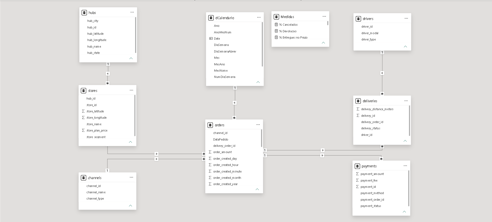
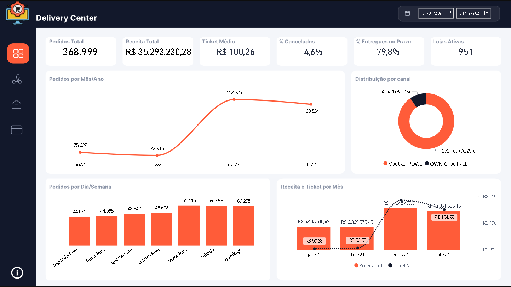
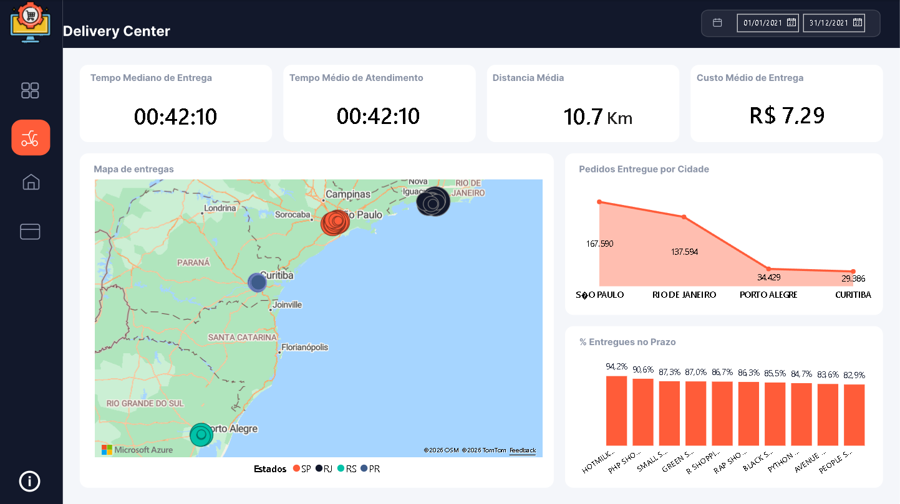
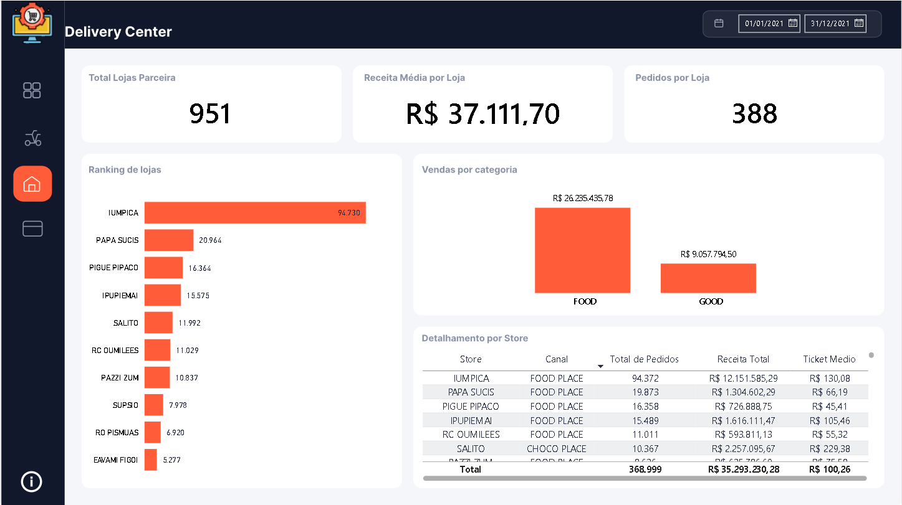
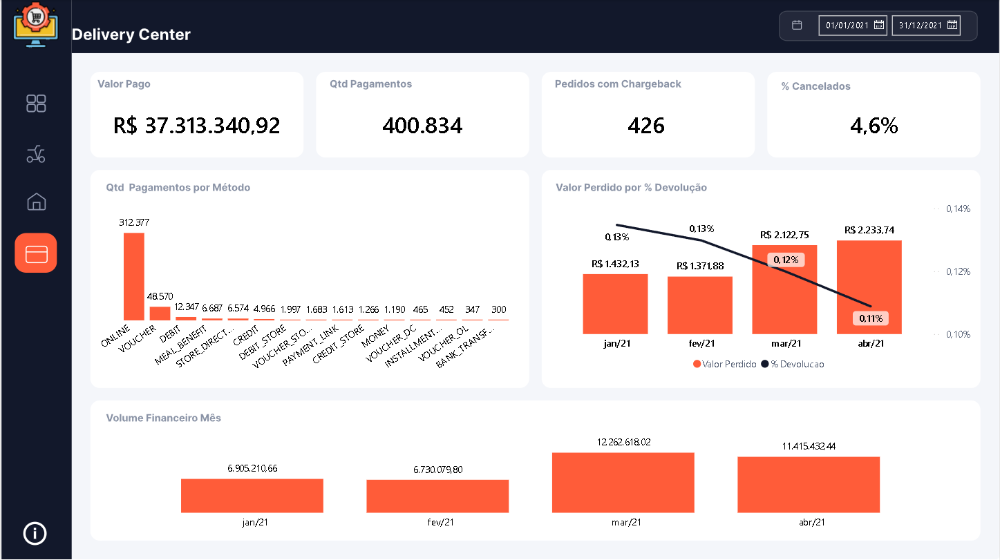
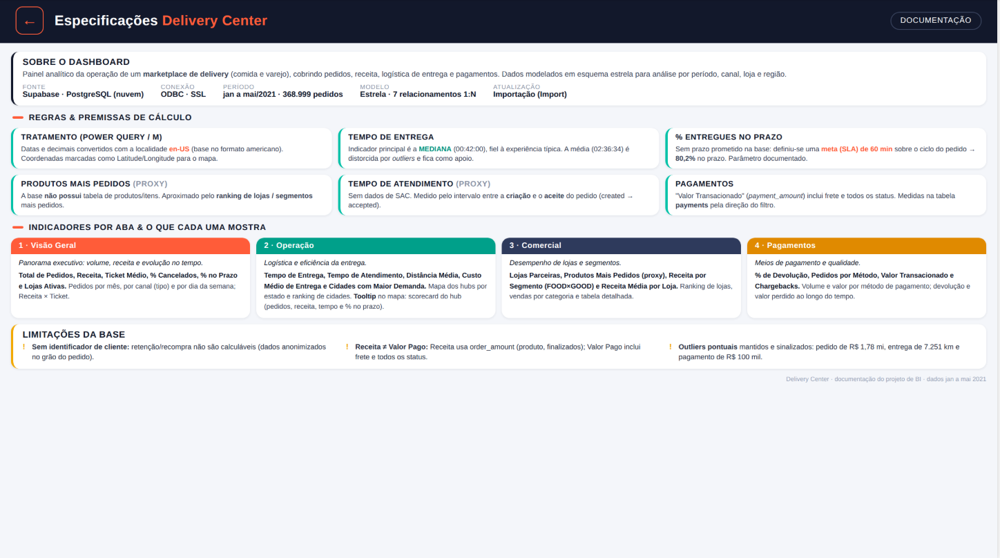

# Delivery Center — Dashboard de Operação em Power BI

Painel analítico da operação de um marketplace de delivery (comida e varejo), cobrindo pedidos, receita, logística de entrega e pagamentos. Dados modelados em esquema estrela, com análise por período, canal, loja e região.

| | |
|---|---|
| **Fonte** | PostgreSQL (Supabase), via Power Query / ODBC |
| **Período da base** | jan–mai/2021 · 368.999 pedidos |
| **Modelo** | Esquema estrela · 7 relacionamentos 1:N |
| **Atualização** | Importação (Import) |

---

## 1. Modelo de dados

8 tabelas em esquema estrela, com 7 relacionamentos 1:N:.

- **Fatos:** `orders` (pedidos), `deliveries` (entregas), `payments` (pagamentos)
- **Dimensões:** `stores` (lojas), `hubs` (centros de distribuição), `drivers` (entregadores), `channels` (canais de venda), `dCalendario` (dimensão de calendário própria — Ano, Trimestre, Mês, Dia da semana)



```
hubs       → stores        (1:N, por hub_id)
stores     → orders        (1:N, por store_id)
channels   → orders        (1:N, por channel_id)
dCalendario → orders       (1:N, por Date/DataPedido)
orders     → deliveries    (1:N, por delivery_order_id)
orders     → payments      (1:N, por payment_order_id)
drivers    → deliveries    (1:N, por driver_id)
```

A dimensão de calendário é construída à parte (não deriva da tabela de pedidos), o que permite granularidade de dia da semana/trimestre sem recalcular em DAX.

---

## 2. Páginas

### 📊 Visão Geral


KPIs do período (pedidos, receita, ticket médio, % cancelados, % entregues no prazo, lojas ativas), evolução de pedidos por mês, distribuição por canal, sazonalidade por dia da semana e receita × ticket médio ao longo do tempo.

### 🏍️ Operação


Indicadores logísticos — tempo mediano de entrega, tempo médio de atendimento, distância média e custo médio de entrega — com mapa geográfico dos hubs (Azure Map) e ranking de cidades por volume e % de entregas no prazo.

### 🏬 Comercial


Desempenho de lojas parceiras: ranking de lojas, vendas por segmento (FOOD × GOOD) e tabela detalhada por loja com total de pedidos, receita e ticket médio.

### 💳 Pagamentos


Volume financeiro, distribuição por método de pagamento, taxa de chargeback e valor perdido por devolução ao longo do tempo.

### 📄 Especificação


Página de documentação embutida no próprio relatório — fonte, premissas de cálculo, o que cada aba mostra e as limitações conhecidas da base. Mantida junto do dashboard para qualquer pessoa auditar os números sem depender de alguém explicar por fora.

---

## 3. Medidas DAX — destaques

**SLA de entrega parametrizado em variável**, não hardcoded em vários lugares:

```dax
% Entregues no Prazo =
VAR SLA = 60
VAR ComCiclo =
    CALCULATE (
        [Pedidos Finalizados],
        NOT ISBLANK ( orders[order_metric_cycle_time] ),
        orders[order_metric_cycle_time] > 0
    )
VAR NoPrazo =
    CALCULATE (
        [Pedidos Finalizados],
        orders[order_metric_cycle_time] > 0,
        orders[order_metric_cycle_time] <= SLA
    )
RETURN
    DIVIDE ( NoPrazo, ComCiclo )
```

**Tempo de entrega convertido de segundos para HH:MM:SS** dentro da própria medida:

```dax
Tempo Mediano de Entrega (min) =
VAR seg =
    MEDIANX (
        FILTER (
            orders,
            [order_status] = "FINISHED"
                && NOT ISBLANK ( orders[order_metric_cycle_time] )
                && orders[order_metric_cycle_time] > 0
        ),
        orders[order_metric_cycle_time]
    ) * 60
VAR h = INT ( seg / 3600 )
VAR m = INT ( MOD ( seg, 3600 ) / 60 )
VAR s = INT ( MOD ( seg, 60 ) )
RETURN FORMAT ( h, "00" ) & ":" & FORMAT ( m, "00" ) & ":" & FORMAT ( s, "00" )
```

**Todas as razões usam `DIVIDE()`**, nunca `/` direto — evita erro de divisão por zero quando um hub ou loja ainda não tem pedido no período (`Ticket Médio`, `Receita Média por Loja`, `% Cancelados`, `% Devolução` etc.).

**Chargeback e devolução calculados sobre pagamentos, não sobre pedidos:**

```dax
Pedidos com Chargeback =
CALCULATE (
    DISTINCTCOUNT ( payments[payment_order_id] ),
    payments[payment_status] = "CHARGEBACK"
)
```

---

## 4. Decisões e premissas (documentadas no próprio relatório)

- **Tempo de entrega:** o indicador principal é a **mediana**, não a média — a média fica como referência auxiliar porque é distorcida por outliers (ex.: um pedido com 7.251 km de distância e R$ 100 mil de pagamento, mantidos na base e sinalizados em vez de removidos silenciosamente).
- **SLA de 60 minutos:** a base não traz um prazo prometido por pedido, então o SLA foi definido como parâmetro do relatório, não inferido dos dados.
- **"Produtos mais pedidos":** a base não tem tabela de itens/produtos — a análise de comercial usa ranking de lojas e segmento (FOOD × GOOD) como proxy.
- **Tempo de atendimento:** sem dado de SAC disponível; usado como proxy o intervalo entre criação e aceite do pedido.
- **Receita ≠ Valor pago:** receita usa `order_amount` dos pedidos finalizados; valor pago (`payments`) inclui frete e todos os status, inclusive cancelados — os dois números não devem ser comparados diretamente.
- **Sem identificador de cliente:** a base é anonimizada no grão do pedido, então recorrência/retenção de cliente não são calculáveis a partir dela.

---

## 5. Tecnologias

`Power BI` `DAX` `Power Query (M)` `PostgreSQL` `Supabase` `Modelagem Dimensional (Star Schema)`
